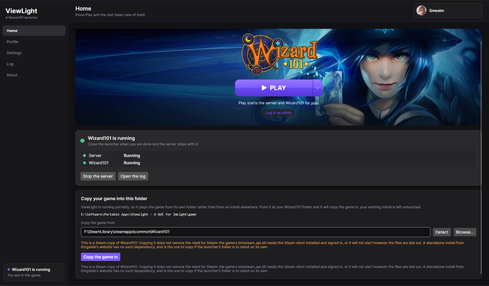
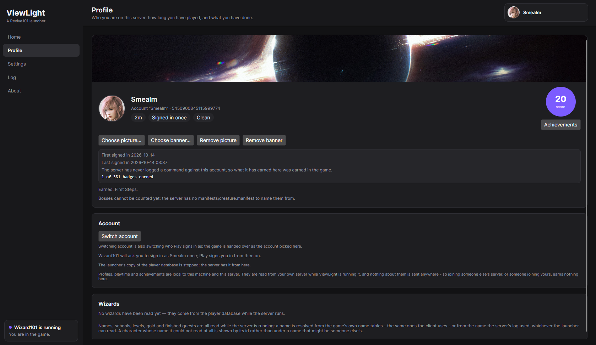
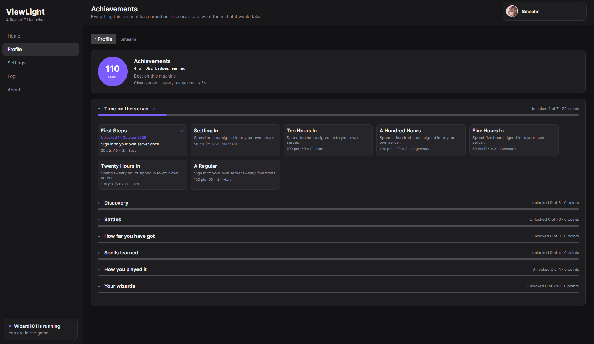
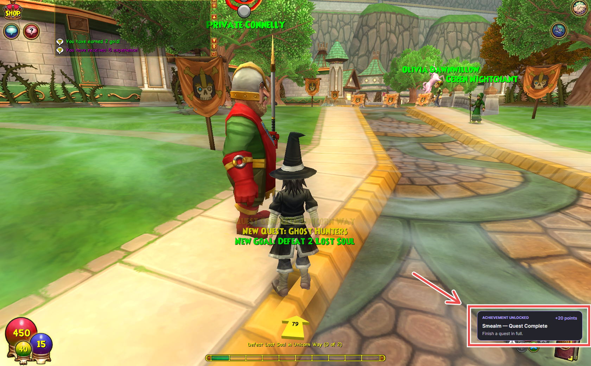

# ViewLight

A launcher for **Imlight**, the [Revive101](https://revive101.de/) private Wizard101 server.

Point it at your Wizard101 folder and press **Play**. ViewLight gets the server for you, sets it up,
starts it, waits until it is genuinely ready, and then starts the game connected to it. It can run a
**patch server** of its own the same way - Aurorium, the Revive101 project's file server - which is what
keeps the game's own files coming from this machine instead of the community's. Closing the launcher
shuts everything it started down again, so nothing is left running behind your back.

- Imlight: <https://github.com/Revive101/Imlight>
- Imlight documentation: <https://revive101.github.io/Imlight/imlight/>
- Revive101: <https://revive101.de/>
- ViewLight: <https://github.com/Smealm/ViewLight> - source, and the newest build as a prerelease

## Why ViewLight

**A private Wizard101 server, on your own account, for one player.** Running Imlight by hand means
finding a server build, unpacking it, editing `Imlight.ini`, starting the server and *then* starting the
game pointed at it. ViewLight does all of that from one button. The point of it is to make a private
server feel like a singleplayer game: your own server on your own machine, running offline, with the
worlds, the quests and the battles all where they should be, and no server to find and no login to type.

What it adds on top is a **profile worth having**. Achievements are earned as you play and they are
scored, and a launcher profile is tied to the server profile that already exists - so the character
levelling up in the game is the same one collecting points outside it. The launcher can also tell whether
an account is **clean**, meaning no server commands have ever been run against it, and a clean account is
worth **double** on everything it earns. That is not a score handed to anybody: it happened on your own
server, and the launcher watched it happen.

All three of the things that follow come from the server and the launcher being on the same machine:

- **It signs you in.** The launcher has direct access to the server it started - its database, its logs,
  its debug output - so it can skip the login screen, watch playtime, and notice accounts and characters
  as they appear.
- **It can point anywhere else.** The caret beside Play launches any other server you name, by address,
  and Wizard101's own servers are two entries in the same menu. That part is not special to ViewLight -
  the client does it by itself with `-L` - it is just easier than typing arguments.
- **It cannot get you banned**, for the reason set out below.

## What it does not do

**ViewLight modifies nothing.** It does not patch, hook, inject or otherwise touch a single byte of
Wizard101's data or memory, and it does not modify the server either. There is no client-side DLL, no
memory editing, no packet rewriting - from the game's point of view the launcher is not there.

**It does not work without Imlight.** There is no standalone mode and there is no plan for one. The server
is what ViewLight installs, configures, runs and plays, and it is also where the database comes from that
the launcher keeps its own notes about an account in - so a launcher with no server has nothing to start
and nothing to keep a profile with. It says that on its first screen rather than showing a Home screen
whose only working button is a download, and it asks for the .NET runtime too when the machine has none for
that database to run in - with the link, the steps, and a button that checks again, so a machine that has
just been fixed is noticed without restarting anything. The launcher itself starts either way: the runtime
is the database's, not ViewLight's.

So where do the profiles and the achievements come from? From the server, while the launcher is running
it. Accounts and characters are read from the server's own player database, and sign-ins, zone entries,
duels and creature kills are read from the server's own log. Auto sign-in works the same way: the launcher
asks the server for the session key it already holds for this machine and hands it to the client, exactly
as the client's `-U` argument is designed to receive it. Reading what a server writes down is the whole
technique, which is why the launcher can do this without touching anything it does not own.

## Screenshots

<table>
  <tr>
    <td width="50%"></td>
    <td width="50%"></td>
  </tr>
  <tr>
    <td><b>Home.</b> The game's banner, the Play button, and one quiet strip for the server underneath it.</td>
    <td><b>Profile.</b> The account Play signs in as, its playtime and standing, and the score circle its achievements open from.</td>
  </tr>
  <tr>
    <td></td>
    <td></td>
  </tr>
  <tr>
    <td><b>Achievements.</b> Grouped by category and scored, with one milestone card per ladder.</td>
    <td><b>Earned.</b> A badge announced over the game as it happens.</td>
  </tr>
</table>

## What it does

- **Finds your game.** *Detect* looks for a Wizard101 install, including ones on a second drive.
- **Downloads the server.** One button fetches the newest Windows build of Imlight and unpacks it into
  a folder you choose.
- **Runs a patch server, or leaves Imlight on somebody else's.** Imlight loads `Root.wad` and the world
  data from a *patch server*, so every session has one and the only question is whose. ViewLight can
  install [Aurorium](https://github.com/Revive101/Aurorium) - Revive101's own file server -  beside the
  server, write its config, start it first and point Imlight at it, which puts the whole stack on this
  machine; or Imlight can be left on a remote one, the public instance by default. An address you set
  yourself is never rewritten.
- **Can fill the patch server in from your own game.** A patch server mirrors the revision Wizard101's own
  patch server is serving, and an installed copy of the game *is* that revision - so the launcher can hand
  it those files instead of waiting hours for them, and the largest of them are files the download can
  never finish at all. Offered once per revision by Play, on demand under **Settings**, or done without
  asking if you tick that.
- **Sets the server up.** Your admin account, the tutorial, the items a new character starts with, the
  realms and ports are all fields that write themselves into the server's own config file.
- **Press Play.** The server starts, warms up, and Wizard101 opens connected to it. You never start the
  server yourself.
- **Signs you in.** Pick an account on **Profile** and Play skips Wizard101's login screen: the launcher
  hands the client the session key the server already holds for this machine, and issues one when it has
  to. Characters are still chosen on the game's own character screen. Your choice is remembered, and so are
  the account names, so the picker is filled in the moment the launcher opens rather than only after the
  server has run once - for the server those accounts belong to. Point the launcher at a different server,
  or open a portable copy that has never run a server, and you get **No profile** rather than somebody
  else's account.
- **Keeps a profile.** **Profile** is who you are on this server: a picture and a banner, how long you have
  played, the wizards on the account, and achievements earned in the game - all kept on this machine, and
  sent nowhere.
- **Plays where you want.** The caret beside Play joins a server somebody else is running - by address,
  from a scan of your own network, or Wizard101's own server - without starting anything locally.
- **Runs from a folder, not just an install.** Put a `portable.txt` marker beside the launcher's
  executable and it keeps everything - settings, server, cached art, and the game if you copy it in -
  inside its own folder instead of `%LOCALAPPDATA%`, so the whole thing can be moved to another drive or
  carried on a USB stick. One caveat comes with it: a **Steam** copy of Wizard101 still needs the Steam
  client installed wherever it is run. A standalone install from KingsIsle's website does not.
- **Keeps itself tidy.** Closing ViewLight stops everything it started - the server and the patch server
  - and asks first while either is running. Both are tied to the launcher, so they stop even if the
  launcher is killed outright. The one thing that outlives the server it was started beside is a patch
  server still fetching its first revision: stopping it would stop the download, so it stays until
  ViewLight closes or you stop it yourself under Settings.
- **Updates without losing anything.** Updating replaces the server's program files and keeps your
  settings.

Home shows two builds: the **server build** installed in your server folder, and the **client build**
the game itself reports. When they do not match, ViewLight says so - that mismatch is the usual cause
of a login that is refused.

## Requirements

- Windows
- [.NET 10 SDK](https://dotnet.microsoft.com/download) to build from source
- **Imlight.** The launcher stops and says so until it can see an Imlight install: it is what ViewLight
  installs, configures, runs and plays, and the RavenDB inside it is also what runs the database ViewLight
  keeps its own notes in - your profiles, playtime and badges, in the launcher's own folder. Point it at a
  folder you already have, or let it download one on that screen.
- **The .NET runtime on the machine, with ASP.NET Core**, which is what runs that RavenDB. A ViewLight
  build is self-contained, so this is not for the launcher itself but for the database it keeps your own
  data in. When it is missing, the same screen says which version the database asks for, links to it, and
  spells out which download on that page to take. Install it and press **Check again** - nothing needs
  restarting.
- Your own Wizard101 install. Imlight ships no game files and neither does ViewLight.
- An internet connection for the first install, and to update later

## Getting started

```bash
dotnet build ViewLight.slnx
dotnet run --project src/ViewLight
```

**Or take a build.** Every ViewLight build is published as a **prerelease** under
[Releases](https://github.com/Smealm/ViewLight/releases); download the `ViewLight-win-x64.zip`, unpack
it anywhere and run `ViewLight.exe`. The launcher itself is self-contained - no admin rights, and nothing
installed for it - though the database it keeps your own data in needs the .NET runtime described under
[Requirements](#requirements).

**The first run asks for two folders.**

| What | Which folder | Example |
| --- | --- | --- |
| Game folder | The Wizard101 install itself - the one holding `bin\` and `Data\` | `C:\Program Files (x86)\Steam\steamapps\common\Wizard101` |
| Server folder | Where the server should live. It does not have to exist yet, and it can be anywhere | `C:\Imlight` |

The game folder is **not** the `bin` folder inside it. That is the easy mistake to make, and ViewLight
notices and corrects it when it can.

**Then it asks for Imlight.** A server folder with no install in it leaves ViewLight on one screen, with the
reason and the folder box: nothing else in the launcher can work without it, so nothing else is shown
until it is there. Press **Download Imlight** (around 260 MB on a first run) or point it at a folder you
already have, then press **Play** - the game starts by itself once the server is up.

## The tabs

| Tab | What is there |
| --- | --- |
| **Home** | The game's banner and the Play button, plus what Play is doing and the two builds. |
| **Home → Play ▾** | Join a server somebody else runs, scan your network for one, or connect to Wizard101's own server. |
| **Profile** | What this machine knows about the account Play signs in as: picture and banner, playtime, standing, the score circle, and the wizards on it. |
| **Profile → Achievements** | Every badge that account has earned on this server, grouped by category, with a milestone card for each ladder. |
| **Settings** | Your folders, everything about the server, the patch server, and every value ViewLight writes into either config. |
| **Log** | Everything the launcher, the patch server and the server have said, in one terminal: boxes for which of the three to show, and runs of the same line folded to a single line with a count. |
| **About** | Versions, links, and what is still missing. |

### What Home tells you while you play

Home says nothing at all until something is happening. Press Play and a status appears: *Getting ready…*,
then *Warming up…*, then *Starting Wizard101…*, then *Wizard101 is running* - with the server's own
progress, such as loading world data, named in the line underneath. Below that a row says where each
thing Play started is - the patch server, when you have one, then the server, then the game - and they
keep saying it once you are in, so you can see at a glance that the server is still up. The row for a
patch server says what the process is doing and nothing else - one that has only just started reads
*Running* whether or not its first fetch has landed, and it is not asked what it holds. If something goes
wrong, that same panel is where it is said, rather than only in the Log.

**Three processes, in order.** With a patch server installed the launcher starts it first and waits for
it to answer, then starts the Imlight server, then the game: that order is the point, because Imlight
reads `Root.wad` from the patch server during its own boot. One button on the same panel stops both
servers - unless the patch server is still fetching, when it stops the server and leaves the download
running, and says *Stop the server* rather than *Stop the servers* so the button matches what it does.

### What the Log shows

The Log is a terminal rather than a list of rows. The launcher's own lines and the server's and patch
server's output are drawn as one run of monospace text that is never wrapped, so a table or a picture a
process printed arrives in the shape it was printed in, and a drag across it copies as much as you like at
once instead of one row per box. The line underneath it says how many lines it is holding, how many are
folded, and how many the boxes are keeping out of sight.

**The three boxes above it choose what is in it** - the launcher, the server, the patch server, or any
mixture of those. Unticking one hides those lines rather than throwing them away: ticking it again brings
them back as long as the Log still holds them.

**A line that repeats is folded.** Thirty lines of `Connection lost, retrying` in a row are drawn as one,
with the count in place of the severity tag - which is what makes a server in trouble readable. Pressing
that line opens the run, so every line is there to read or copy with the time it actually arrived, and
pressing it again folds it back up. Only lines that arrive *next to each other* and are otherwise identical
fold together - the time is not part of what makes two lines the same - and a run stays as you left it
until the Log fills up and that run's oldest lines fall off the top.

### What Profile shows

**Profile is who Play signs in as, and it starts with the profile itself**: a picture and a banner you
choose (both are copied into the launcher's own folder, so they survive the originals being moved or
deleted), the time that account has spent on this server, how many times it has signed in, and whether it
still counts as clean. Beside them is the **score circle**: what the account is worth on this server, and
the one button that opens its achievements. Under it is **Switch account** - a button rather than a box
across the card, because a launcher with one account is not making a choice, and the list it opens is the
same one Play signs in from - then the account's wizards.

**The account is drawn in the corner of the window**, on every page rather than only on Home, because who
is signed in is a state the launcher is in rather than a step on the way to pressing Play. Closed, it is
the picture and the name. Clicking it opens it into the banner, the name and the score; clicking that
takes you to the account section; and the pointer leaving it folds it back to the picture and the name
after a moment.

**Each wizard is shown the way the game shows it**: its name, its school, and the level it has reached,
with its gold and finished quests alongside. Level, gold, quests and school are read from your server's
player database, which only answers while the server is running. A name is the one thing the database does
not hold as text - Imlight keeps the table indices the name was built from - so it comes from the server's
log when that names the wizard signing in, and otherwise from the game's own name tables in `Root.wad` when
the launcher can find them. A character neither source can name is shown by its id, which is ugly and true
rather than a name that may be somebody else's.

**Achievements are a screen of their own, grouped, scored, and start shut.** They open from the score
circle on the profile, under the account they belong to, and they are read rather than glanced at: every
badge sits under its category - time on the server, battles, your wizards, and so on - and each heading
carries how many of them are unlocked and what they have scored, so the screen opens as a list of
categories rather than a wall of badges. The long ladders
are **milestone cards rather than rows of badges**: one per school, saying which level that wizard has
reached, what the next milestone is, how far away it is and what it is worth - a rung every five levels up
to your server's own level cap (`Character.MaxLevel` in `Config/Imlight.ini`, 200 by default) - plus a card
for **every ten duels won** and one for **every twenty-fifth creature beaten**, which run as far as your
server's own creature list does. Each rung is worth more the further along it sits. A profile the server has
never logged a command against is **clean**, and its badges count **double** - how much, and why, is on the
card beside the score. Milestones arrive in runs while you are levelling or farming, so **Settings →
ViewLight Settings** has a switch to stop announcing them; the badge is still earned, still counted, and
still on the profile when you turn it off.

**Discovery is what you have been to.** The zones a wizard has entered come from the server's log, and the
world each one belongs to is learned from the server's own account of loading it: the log names a zone
twice over, once by the path it came from - which begins with the world, `WizardCity/WC_Streets/WC_Unicorn` -
and once by the name the game calls it, `WizardZone_UnicornWay`. So **Discover Wizard City** and its like are
earned against your server's real worlds rather than a list written down in the launcher, and the Discovery
group shows each world you have been in with the zones you have found inside it. Nothing is guessed: a zone
the server only numbers - a house, an instance, `WizardZone_00000878` - is recorded as somewhere you were,
and never as a place with a name.

**A brand new launcher has no profile, and says so.** An account belongs to a server, so until a server
has been downloaded *and* its `Config/Imlight.ini` names an admin username and password, there is no
account at all and the screen reads **No profile** rather than showing an empty box. Once there is one, the
screen names it - that admin account is the only one a server has before anybody has signed in - and tells
you what to do with it: sign in as it in the game and say `.account create $username $password`. The two
steps are written out under **Settings → Making another account** rather than offered as a form, because the
server is what makes an account and the launcher only ever reads them. Every account appears as a profile of
its own once the server has been started.

**Playtime and achievements are local, and only as good as what the launcher saw.** They come from your
own server while ViewLight is running it - the player database's list of who is signed in, and the server's
log - so joining somebody else's server, or somebody joining yours, earns nothing here. A profile that was
played while the launcher was closed simply has no time recorded for that stretch, and the zone and duel
achievements need the server's log level turned up to `DEBUG`, which the Profile tab offers to do for you.

### Playing on another server

Press the caret beside **Play** to choose somewhere else to play. The left half of the button still
means "start my server and the game", exactly as before.

| Choice | What happens |
| --- | --- |
| **Play (start the server here)** | The usual: the patch server starts first if you have one, then the Imlight server, which waits until it is ready, and then Wizard101 opens connected to it. |
| **Join a server…** | Points Wizard101 straight at an address you type. Nothing is started here. |
| **Find servers on my network** | Asks every address on your network whether anything is listening on port 12000, and lists what answers. |
| **Wizard101 official — standard account** | Connects to `login.us.wizard101.com:12000` with a standalone Wizard101 account. |
| **Wizard101 official — Steam account** | The same, for a Steam-linked Wizard101 account. |

Three things are worth knowing about joining:

- **You are not signed in automatically.** Automatic sign-in uses a session key the server itself
  issued, so it only works on the server this launcher runs. Joining anywhere else shows Wizard101's own
  login screen, and the account picker on Profile says so.
- **Steam or standalone matters.** A Steam-linked Wizard101 account cannot sign in to Wizard101's own
  server without a launch argument a standalone account must not be given, so the two are separate
  choices rather than a guess. Picking the wrong one is refused at the login screen.
- **A server on another network cannot be found for you.** Nothing publishes a list of Imlight servers,
  so it has to be typed in by address, the way a Minecraft server works. A device that answers a scan is
  only *something listening on 12000* - a good guess, not a promise.

## Your settings

There are two kinds, and they are kept separately.

**ViewLight's own settings** live under **Settings → ViewLight Settings**: the theme (*System*, *Light*
or *Dark*), the page the launcher opens on, whether closing it asks first while the server is running, and
whether milestone achievements are announced as toasts.

**The server's settings** are fields in Settings that write straight into the server's own
`Config\Imlight.ini`. That file is the server's, not the launcher's: ViewLight only changes the values
you can see and leaves the rest of the file - comments included - exactly as it was.

| What | Config key |
| --- | --- |
| Administrator account the server creates for you | `AdminAccountUsername`, `AdminAccountPassword` |
| Skipping the tutorial, and what new characters start with | `TutorialDisabled`, `DefaultItems`, `StartingLevel`, `StartingZone`, `BaseGoldPouch` |
| The realms you offer, and the ports they use | `GameServerIP`, `GameServerPort`, `GameServerCount`, `RealmNames`, `LoginServerPort` |
| The server's own database port | `EmbeddedDatabasePort` |
| Where `Root.wad` is downloaded from | `PatchServerInternalUrl` |
| The port Imlight's *own* patch server listens on, for the client | `PatchServerPort` |
| World data and logging | `SpiralDBAutoFetch`, `LogLevel` |
| Which client revision is accepted | `GameRevision`, `EnforceRevision` |

**Accounts are made by the server, inside the game.** ViewLight does not write into your server's player
database: that storage is the server's, and the server's own way of making an account is its own command.
Sign in as the admin account, say `.account create $username $password` in the chat, close the client, and
the account is offered on **Profile** as a profile of its own. The launcher only ever reads that database -
the account list, the picker and the profile are all reads - and one consequence is worth knowing: a server
that has never booted has no database and no accounts, so **Profile** says **No profile** until it has.

**The administrator password is put on the account, not just written into the config.** Imlight creates
that account once and never applies a later password change to it, so a password changed here afterwards
would leave the account on the old one and the game refusing the password this screen shows. Whenever
ViewLight reads the player database and finds the admin account on a different password, it puts the
configured one on it - the Log and the line under **Settings → Administrator account** say when it has,
and *Generate* then means what it looks like it means. It also makes `Imlight.ini` the authority on that
one password: one changed in the game, as an administrator with `.account password`, is put back to the
config's the next time the database is read - so change it here instead.

**Starter items are fussy on purpose.** A character needs at least two items and the server can grant at
most sixteen, so ViewLight refuses to save a list outside that range and explains why. *Apply starter
settings* fills in the usual pair - a Tier 1 wand and the tutorial deck - for a fresh server.

**Skipping the tutorial does not also do what the tutorial does.** `TutorialDisabled` drops a new
character into the starting zone, but the school's first spell, the starter items being equipped and the
tutorial's own items are all things the *tutorial* gives it rather than things the server grants behind
the scenes - so a character that skipped it arrives without its school spell, with the starter kit in the
bag rather than on, and can be handed the tutorial items a second time. The setting says so where it is
turned on. The fix is in the game: walk to Ravenwood, learn your school's spell from the trainer, then
equip the starter items out of your inventory.

**Two values move themselves.** If the server's database port is still on the default 8080 and something
else already has it, ViewLight moves it to a free port, because the server will not start otherwise. If
the patch server address is blank or points at a local address with nothing answering it, ViewLight
points it at the public one the Revive101 team runs. Anything you have set yourself is left alone.

**A third can, if you ask it to.** `GameRevision` is the client revision this server accepts, and a server
build pins the one it was published with - which the game has usually moved past by the time you play.
**Make the server accept the patch server's revision**, in the patch server card below, sets it from the
revision your patch server actually holds, so the game you have is the one that gets in and your own patch
server can serve it.

**The patch server card asks one question: whose patch server.** Imlight cannot boot without one, so the
card opens with **Run one on this machine** or **Use a remote patch server**, and everything else follows
from that answer.

- *Run one on this machine* gives it a folder (Aurorium, about 9 MB, one executable), a port written into
  its own `config.toml`, and **Start it with the server, and stop it with the server** - what installing
  one turns on. While that is ticked, Play starts it before the server, stops it with everything else, and
  writes this machine's address into Imlight's `PatchServerInternalUrl` so the server loads its files from
  here; every start checks that, so a reinstall or a hand-edited config is put right by pressing Play.
  Turn it off and ViewLight neither starts nor stops it, which is for somebody who starts Aurorium
  themselves - *Use this patch server* writes the address by hand for that case. Under it, **Fill it in
  from the game folder if it has nothing yet, without asking** is the copy below, done as part of Play.
- *Use a remote patch server* is an address and nothing else: the public instance by default, or one of
  your own. The launcher never rewrites it, and a remote patch server is never started or stopped here.

**It has to fetch the game's files before it can serve any.** Aurorium starts answering within seconds,
but it then downloads that revision of the game from Wizard101's own patch server - 3,825 files, about
18 GB of them, so hours rather than minutes on anything but a fast link - and until a file arrives it
answers every request for that file with `404`. Three things matter here, and all of them are the
difference between a patch server that fills up and one that never does:

- **Leave it running.** The fetch only advances while the process is alive. ViewLight no longer stops a
  patch server that has not finished fetching when the server stops, because that is the download being
  cancelled; it stays until ViewLight closes or you stop it under Settings. Aurorium also retries a file
  it could not get after five minutes rather than after the eight hours it ships with - a large file can
  be aborted by its own two-minute request limit, and eight hours of waiting is what "it is up and nothing
  is happening" looks like.
- **ViewLight tells you where it stands.** Before the server starts, the launcher asks the patch server
  for this session's `Root.wad` - the same request Imlight makes first - and puts a line in the Log when
  the answer is `404`: the patch server has not fetched this revision's files yet, the fetch keeps running
  while the launcher is open, and pressing Play again once it has finished gets its files from here.
- **The copy of the game on your machine can hand it those files instead.** A patch server mirrors the
  revision Wizard101's own patch server is serving, and an installed copy of the game is that same
  revision - a Steam build holds exactly it, measured file for file against a real fetch: 2,700 files
  compared byte for byte, none different. So the launcher can fill a patch server in from an install that
  already has the game, and what it copies in are the files that would otherwise have been downloaded.
  Two places do it, and both ask first - unless the card's **Fill it in from the game folder if it has
  nothing yet, without asking** is ticked, when Play just does it: **Copy the game's files in**, under the
  patch server card, and Play, which offers it once per revision just before the server starts - the
  moment it is worth having, because that is when Imlight reads `Root.wad` from the patch server. It is worth more than the time it
  saves: the largest files of a revision run past Aurorium's own two-minute request limit and can never
  arrive from the download at all, so for `GUI-WorldData.wad` and its kind a copy is the only way they get
  there. **Settings → Patch server (Aurorium)** says how many files it holds of the revision, how many of
  the rest are on this machine and how much they weigh, before anything is copied.

  Nothing is overwritten and nothing is invented. Only files of the right name and the right length go in,
  from an install whose revision is the one the patch server is holding - a build of any other revision is
  refused, not copied - and every file is written aside and moved into place, so a copy interrupted
  halfway leaves nothing that the patch server would mistake for a downloaded file. Running it again
  copies only what is still missing, so it can be used again after the game patched itself, and a copy is
  safe to make while the patch server is fetching: both are writing the same files.

Nothing is repointed on that answer. While the patch server is up, Imlight is pointed at this machine -
the address and the port you chose - and a session started inside a first fetch loads `Root.wad` from
Imlight's own cache, or stops on the `404` with the Log line beside it. Nothing waits on the fetch either,
so Play is never a spinner for a fetch nobody asked for. The one wait it does add is a copy the user
chose, and that one is on screen as it happens.

**What ViewLight never does is point Imlight somewhere else.** While a remote patch server is the one
chosen - and while nothing is installed here - the address in Imlight's `PatchServerInternalUrl` is left
exactly as it is. The public patch server, or an Aurorium somebody else runs, is a choice rather than a
fallback, and an address you typed is never rewritten.

**A patch server can only hold what Wizard101 currently offers, so the revision your server accepts can be
made to follow it.** Imlight asks its patch server for `{address}/V_{GameRevision}` and, with the revision
check on, accepts only clients on that same revision - while an Imlight build pins the revision it was
published with, which is older than the game the moment the game is patched. The two then disagree, and
the game is the thing that loses: the address Imlight asks for does not exist, and the client that was
patched into it is refused. **Make the server accept the patch server's revision**, in the patch server
card, reads the revision your patch server actually holds and writes it into `GameRevision`, so the server
asks for what is there and the client it was patched into is the one it accepts. It is off by default,
it is applied every time the launcher starts the patch server, Play's own start included, and when it is
turned on while one is already running - the `GameRevision` box under **Network** is greyed out while it is on, and the line under that box
says whether it has been set yet. Turning it off puts the value the config had before back, unless
something else has changed it since.

Its port is the one thing worth changing, and only if something else already has 12369: that is both
Aurorium's default and the address Imlight's own stock config carries, so a patch server on it is used
even before anything is written down.

## Known issues

Rough edges, not faults, and every one of them has a way through.

**The first account is the server's admin one, and it only exists once the server has booted once.**
Imlight creates it from `Config\Imlight.ini` on its first start, and it is the account `.account create`
is typed as in the game. Before that there is no player database, so **Profile** says **No profile** and
there is nothing to sign in as. Press **Play** once - or start the server from Home - and it is there.

**The first server run is slow, and it can crash once.** It downloads its assets, which is a few hundred
megabytes, so the first boot takes minutes rather than seconds. Once the download finishes the server can
still stop by itself for a reason nobody has pinned down yet. **Press Play again** and it starts normally.
After that first successful boot it has not been seen to happen again.

**Loading into a new area can be slow on the public patch server.** Zones are fetched from the patch
server, and the Revive101 one is someone else's machine: it is not on your PC and it does not have
KingsIsle's infrastructure, so a busy day there is felt as a slow zone load. The server is local; the
assets are not. **This is what a local patch server fixes** - see [the patch server card](#your-settings)
- though a first start still has to fetch whatever it does not already have from Wizard101's own patch
server. Hand it the files your own game already has and it is ready as soon as it starts - see the patch
server card - and leave it running while the rest arrives: sessions are served from this machine from then on.

## When something goes wrong

**Profile says "No profile".** That is the honest answer rather than a fault: an account exists only once
a server here has made one, and a name remembered from another server is not one. Download the server
under **Settings** if it is missing, and check that **Settings → Administrator account** names both a
username and a password - Imlight creates that account the next time the server boots, and it is what the
screen shows until your own accounts turn up in the database. New accounts are made in the game, signed in
as the admin one: `.account create $username $password`.

**The first screen says Imlight is missing, or that its database cannot run here.** The launcher is standing
down until that is fixed, because nothing else in it works without a server. If it names a folder, point it
at one you already have or press **Download Imlight**. If it names the .NET runtime, that is the database:
the RavenDB the server ships is a framework-dependent program, and this machine has no runtime for it. The
screen says which version it wants and links to it, and **Check again** notices the install without
restarting the launcher.

**Play says Wizard101 was not found.** The game folder is wrong. Check it under **Settings → Game
folder**; the status line underneath says what is and is not there.

**The server starts and then stops by itself.** Read the failure line on Home, then the **Log**. The most
common cause is the patch server: the server downloads `Root.wad` from it, and it cannot start without
that. The Log quotes the server's own last error lines, and ViewLight will have already repaired a blank
or unreachable patch address on its own.

**The patch server row says something is wrong.** Home shows a row for it while one is installed, with
the same dot and the same words the server uses: *Starting*, *Warming up*, *Running*, *Stopped
unexpectedly*. A patch server that will
not start is **not** a failed session - Imlight keeps its own cached copy of `Root.wad`, so the server is
started anyway and the Log says so. If it happens every time, check the port under **Settings → Patch
server (Aurorium)**: two things cannot listen on one.

**`404 (Not Found)` while downloading `Root.wad`, from a patch server on `127.0.0.1`.** Your local patch
server has nothing to serve yet: Imlight asks for `.../V_{revision}/Data/GameData/Root.wad`, gets a `404`,
and stops. ViewLight leaves it at that - the address is the one you set, and it is not rewritten - so the
first few minutes of a patch server's first fetch look like a broken server rather than a waiting one. Two
causes are worth knowing apart:

- *The first fetch has not finished.* Aurorium starts answering within seconds and then downloads that
  revision from Wizard101's own patch server - 3,825 files, about 18 GB of them - so it is an hour or more
  of running, not minutes. The launcher says so in the Log before the server starts, and leaves the patch
  server running when the session ends. Press Play again once the Log stops mentioning it - the file
  Imlight needs first is the 281 MB `Root.wad` - or hand it the files your own game already has, which is
  most of the revision and the only way the largest files arrive at all (see the patch server card).
- *The revision it holds is not the one your server asks for.* Aurorium fetched what Wizard101's patch
  server **currently** offers, while your Imlight is pinned by `GameRevision` to an older build. **Make the
  server accept the patch server's revision**, in the card above, points the server at the revision the
  patch server holds, and a session is served locally from then on. The public patch server may well still
  have the older build; a local one cannot, unless it fetched it back when it was current.

**"TcpListener for Imlight.Patch on port 12500 failed" (socket error 10048).** Imlight's own patch
server - the one the *client* talks to, which relays what Imlight downloaded - could not take its port.
Something else holds 12500: most often a previous Imlight that never shut down (ViewLight stops a left
over server it started itself before starting a new one, but one started by hand is not its business), or
the launcher's patch server pointed at 12500, which ViewLight now warns about in the card.

**A login is refused.** Compare the two builds on Home. The server accepts one client revision
(`GameRevision`), and if your game has been updated past it the client is turned away. Updating the server
is the usual fix - but note that an Imlight build pins the revision it was published with, and the newest
build may still be older than your game, in which case no update helps. Turn on **Make the server accept
the patch server's revision** in the patch server card and the accepted revision becomes the one the patch
server holds, which is the one your game has just been patched to.

**Wizard101 will not start from the launcher's folder.** If the game came from Steam, it still needs the
Steam client installed and signed in - copying the files does not remove that. Copy a standalone install
from KingsIsle's website instead, or point the launcher back at the Steam install where Steam put it.
Home says so as soon as you choose a Steam folder.

**Anything else.** The **Log** tab has everything both processes said, in order - folded where a line
repeats, and with a box to quieten any one of the three down to the others.

## Where ViewLight keeps its files

Everything it stores about itself - which folders you chose, which build is installed, the art it has
cached, the launcher's own database, and the profiles with their playtime and achievements - is under
`%LOCALAPPDATA%\ViewLight`. Deleting that folder resets the launcher, profiles included; it does not
touch your game or your server or your patch server. Downloaded releases are cached under `downloads`
there, so a retry does not re-download 260 MB; the patch server's cached build is cached the same way.

The launcher runs a database of its own - `database` there, started from the RavenDB the Imlight install
ships and held for the whole run - and that is where its own notes about a server live: one document per
profile carrying its playtime and its badges, one for which world each zone turned out to belong to, and
each profile's picture and banner stored as attachments on its own document. Portable mode puts that
database in the launcher's folder too, so a copied folder arrives with its profiles in it. The server's own
database is the other one, and it stays where Imlight keeps it, inside the server folder.

**A `profiles.json` from an older build is moved across once**, the first time the launcher starts with
the database: its profiles, playtime, badges and pictures become documents in it, and the file is kept
beside them as `profiles.json.imported`. Nothing is deleted, and the move is never done twice - a copy of
that file restored from a backup afterwards is left alone, because the database is the newer of the two.

The **patch server** lives wherever its folder points - `%LOCALAPPDATA%\ViewLight\patchserver` by
default, or inside the launcher's own folder in portable mode. Beside its executable it keeps
everything it fetched: `config.toml`, `aurorium.db`, and the game's files under `data`. That folder is
the download, not the cache: keeping it is what makes the next session local, and deleting it means the
next one fetches the game's files again.

### Portable mode

Put a file called `portable.txt` next to `ViewLight.exe` (an empty one is enough, and **Settings →
Portable mode** creates it for you) and the launcher keeps everything in its own folder instead: its settings, its server, and the game if you copy it in. Folders *inside* the
launcher's folder are written down relative to it, so the folder can be moved to another drive or
another machine - or carried on a USB stick - and still find everything; a folder somewhere else is
written down as the full path, because that is genuinely where it is.

**Settings → Portable mode** switches it on or off and offers to copy your Wizard101 install into the
launcher's folder, which is what makes the launcher self-contained rather than merely self-locating. Copying
takes a few minutes and several gigabytes, and it is a copy: your original install is left exactly as it
was. Turning portable mode on or off needs a restart, and the launcher says so.

**The Steam caveat.** If that install came from Steam, copying it does not remove its need for Steam. A
Steam copy of Wizard101 loads its own `bin\steam_api.dll` to talk to the Steam client, so with Steam not
installed and signed in the game will not start - wherever the files happen to be. A standalone install
from KingsIsle's website has no such dependency and is the one to copy. ViewLight says this before thecopy starts, on Home whenever a Steam folder is chosen, and again in the report afterwards.


## Fork it

Feel free to fork the launcher and open a PR. This is an example project, written over a day out of a
long-standing love of the game and the novelty of Imlight finally existing - private-server software that
lets Wizard101 be played offline. The server is the hard part and it is not mine; this launcher is a
nicer way to set it up and configure it, plus the things you can only do because you are running your own
backend on the same machine as the client.

## Building and testing

```bash
dotnet build ViewLight.slnx
dotnet test ViewLight.slnx
```

The launcher is a .NET 10 application using Avalonia, so the window is drawn by the launcher itself and
looks the same on any platform that can run it.

## Not done yet

- **Item names in the starter-item picker** come from Imlight's own list rather than from the game.
  Reading the real names out of the game's `Root.wad` is a separate piece of work.
- **Imlight's own first-boot crash** is not worked around by the launcher; pressing Play again is the way
  through it (see [Known issues](#known-issues)).
- **A local patch server still fetches its first revision from Wizard101.** It has to: that is where the
game's files live. Once they are here the client is served from this machine - the launcher can point the
server at that revision too, see *Make the server accept the patch server's revision* - but the run that
fills it is a long one: the launcher starts it and reports on it rather than waiting, and shows no progress
for it beyond what Aurorium itself logs.
- **Choosing an older server build** - ViewLight always takes the newest release.
- - **The revision mirror only asks this machine's patch server.** With a remote patch server in use it has
  nothing to read and does nothing, which is the case it would be most useful in: the public instance is
  likelier to hold a build older than your game than a local one is. It is written up in
  [docs/design-notes.md](docs/design-notes.md) rather than fixed quietly, because whether it should hide
  itself in that branch or ask the configured address is not obvious.
- **Profiles that travel.** A backup to a cloud drive is planned rather than built, and is written up with
  the rest of the next round of work in [docs/design-notes.md](docs/design-notes.md).
- **A Linux build.** The server has one, but the game client is a Windows program, so this is a bigger
  question than it looks.

Why things are the way they are, including what has been measured on a real install, is written up in
[docs/design-notes.md](docs/design-notes.md).
